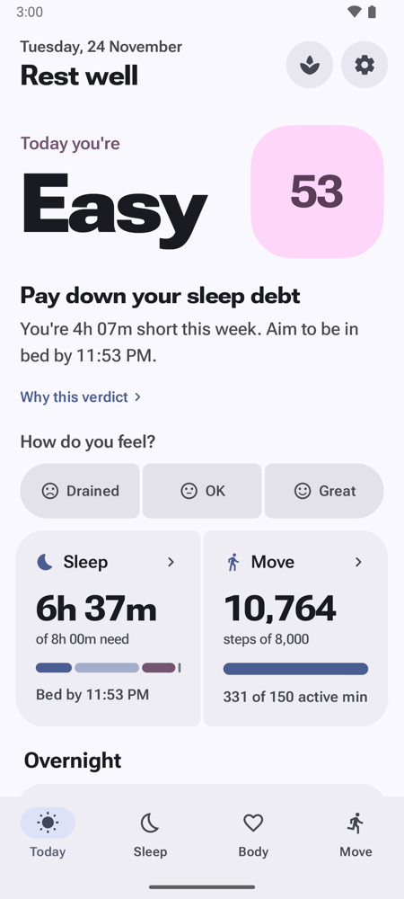
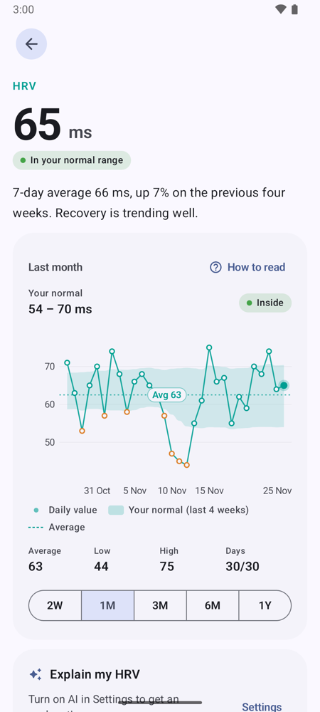
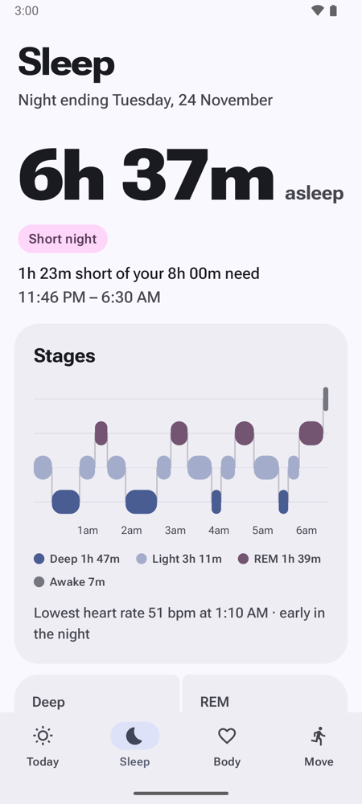
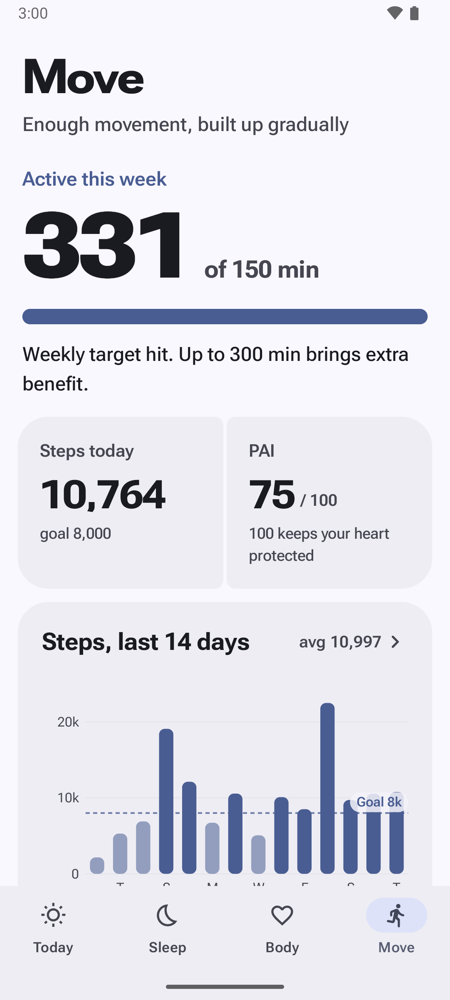
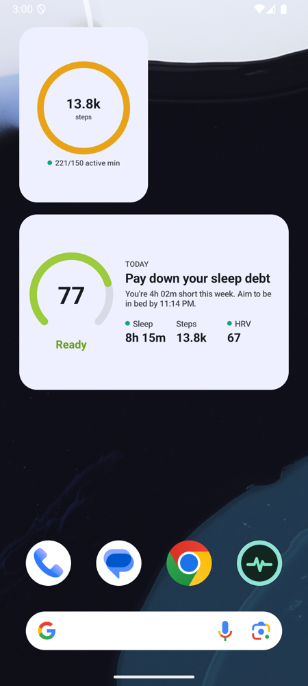

<p align="center">
  
  
  
</p>

# Baseline

<p align="center"><a href="https://github.com/SelinJodhani/baseline/releases/latest"><b>⬇ Download the latest APK</b></a> · Android 10+</p>

**A calm, minimal Android dashboard for your Amazfit / Zepp data.** One verdict a day, three numbers that matter, and a plain-language story behind every metric. Everything runs on your own server.

The Zepp app shows you everything and tells you nothing. Baseline does the opposite. It compares you with **your own 60-day normal** and answers three questions:

1. **How recovered am I?** Readiness from overnight HRV, resting heart rate and sleep, with the reason shown.
2. **How did I sleep?** Duration against your need, sleep debt, rhythm, and a bedtime for tonight.
3. **Did I move enough?** Steps, WHO active minutes, and training load.

Then it gives you **one thing to do today**.

## Features

- **Today:** a single readiness score with its contributors, one focus sentence, and sleep and movement at a glance.
- **A story for every metric:** your personal takeaway, an interactive trend with your normal range, *why it matters*, *what to look for* and *how to improve*. Each story is based on the research in [docs/RESEARCH.md](docs/RESEARCH.md).
- **Body:** every signal in one quiet list. HRV, resting HR, breathing, sleep rhythm, night oxygen, VO₂max, steps, load, stress and weight.
- **Widgets:** Today, Readiness, Sleep and Move for the home screen and, where supported, the lock screen. Add them in one tap from Settings.
- **Optional AI brief:** a three-sentence morning brief from Google Gemini, using your own key. Only a text digest of the numbers on Today is sent.
- **Material You:** follows your wallpaper colours, with light and dark themes and no gradients.
- **Private by design:** no accounts, analytics or cloud. The token is encrypted with the Android Keystore, and nothing goes into backups.
- **Honest data:** a missing reading is a gap, never a zero. Unreliable metrics (sleep stages, SpO₂, stress) are labelled as such.

<p align="center">
  
  
  
  
</p>

## How it works

```
Amazfit ─► Zepp app ─► Zepp cloud ─► ZeppBridge (your server, SQLite)
                                          │ read-only export
                                          ▼
                                   Baseline Bridge ──HTTPS / Tailscale──► Baseline (Android)
```

- **[ZeppBridge](https://github.com/lingcang728/ZeppBridge)** pulls your full Zepp history into a local library.
- **[Baseline Bridge](bridge/)** is one stdlib-only Python file in a container. It turns that library into a compact JSON feed, protected by a token.
- **The app** does all the analysis on your phone. See [docs/METRICS.md](docs/METRICS.md) for every formula.

## Get started

**→ [Full setup guide](docs/SETUP.md)** covers ZeppBridge, the bridge, Tailscale and pairing. It takes about 30 minutes.

Just want to look? Install the APK from [Releases](https://github.com/SelinJodhani/baseline/releases) and tap **Explore with demo data**.

## Build from source

```bash
cd android
./gradlew :app:assembleDebug          # JDK 21, Android SDK 37
./gradlew :app:testDebugUnitTest      # insight engine tests
python3 -m unittest bridge/test_baseline_bridge.py
```

The stack is Kotlin, Jetpack Compose with Material 3, Glance (widgets), WorkManager, DataStore + Tink, and kotlinx.serialization. It has no networking or charting libraries: the charts are hand-drawn on Compose Canvas.

## Disclaimer

Baseline is a personal dashboard, not a medical device. It doesn't diagnose anything. If something feels wrong, talk to a doctor.

## License

[MIT](LICENSE). ZeppBridge is a separate MIT-licensed project and isn't affiliated with Zepp Health. Amazfit and Zepp are trademarks of Zepp Health.
