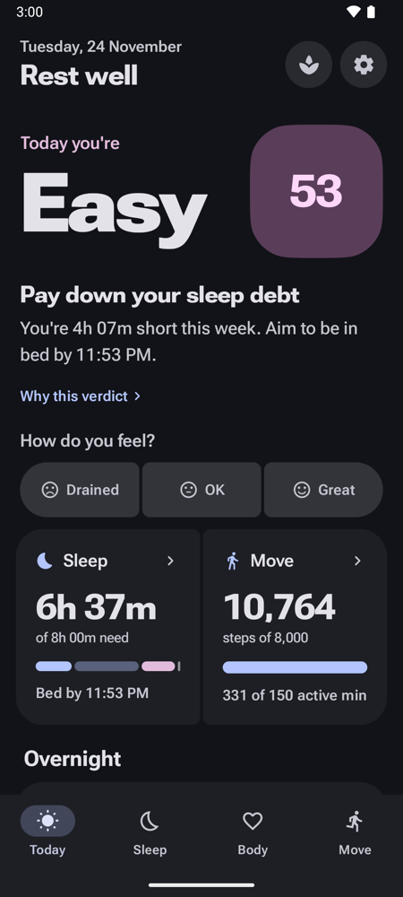
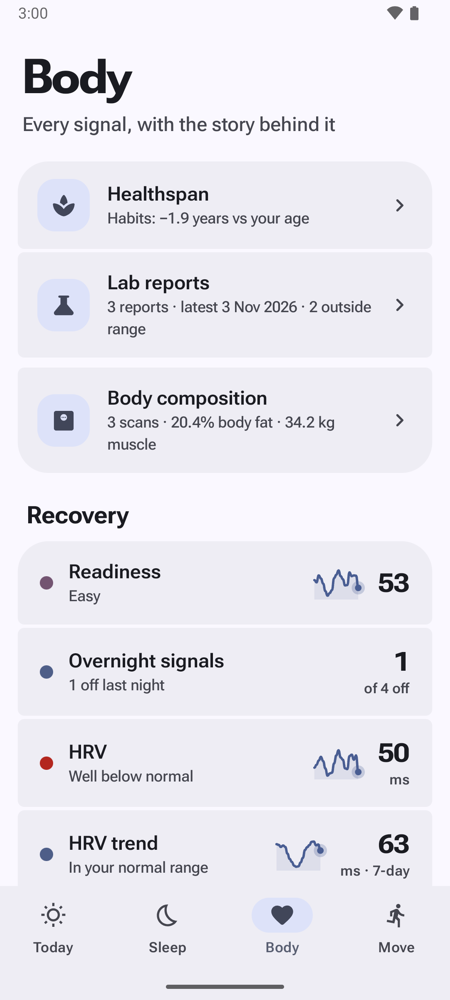

<p align="center">
  
  
  
</p>

# Baseline

<p align="center"><a href="https://github.com/SelinJodhani/baseline/releases/latest"><b>⬇ Download the latest APK</b></a> · Android 10+</p>

**A calm, minimal Android dashboard for your Amazfit / Zepp data.** One verdict a day, three numbers that matter, and a plain-language story behind every metric. Everything runs on your own server.

The Zepp app shows you everything and tells you nothing. Baseline does the opposite. It compares you with **your own 60-day normal** and answers three questions:

1. **How recovered am I?** Readiness from overnight HRV, resting heart rate and sleep, with the reason shown.
2. **How did I sleep?** Duration against your need, sleep debt, rhythm, and a bedtime for tonight.
3. **Did I move enough?** Steps, WHO active minutes, and training load.

Then it gives you **one thing to do today**.

## Features

- **Today:** readiness as one word (Push, Ready, Easy, Recover) with what drove it, a one-tap "How do you feel?" that softens the advice when you disagree, one focus sentence, and sleep and movement at a glance. Tap the score for a plain-language "why".
- **A story for every metric:** your personal takeaway, an interactive trend with your normal range, *why it matters*, *what to look for* and *how to improve*. Each story is based on the research in [docs/RESEARCH.md](docs/RESEARCH.md).
- **Charts you can read:** every line, band and target is labelled, scores show their named zones (for example Irregular / Fairly regular / Regular), tap any day for a tooltip, and **How to read** explains what the number means with small diagrams.
- **Healthspan:** how your habits, fitness and blood compare with your age. Habits use Google Research's [Coachable Health Age](https://arxiv.org/abs/2611.08568) (90-day sleep, daily lowest heart rate, steps and active zone minutes, computed by the bridge from minute heart rate), with what each habit adds or takes off and the exact changes worth the most years. Blood uses Phenotypic Age (Levine 2018) from your lab reports; fitness uses VO₂max for your age. Trends over months, never a daily push; an optional AI 12-week plan.
- **Body:** every signal in one quiet list, including an early "signals off" warning, the Sleep Regularity Index, sleep need and social jet lag, HRV trend, overnight heart-rate low, time in zones and a suggested movement range for today.
- **Widgets:** six flat Material You widgets in their own shapes (circle, capsule, squircle, scalloped) for the home screen and, where supported, the lock screen, which shows words only. Add them in one tap from Settings.
- **Fresh data on demand:** if your data is stale, Today tells you why: the watch syncs to the Zepp cloud only through the Zepp app. One tap opens Zepp, and **Sync now** pulls the cloud right away.
- **Built-in updates:** new versions install from GitHub Releases, checksum-verified.
- **Lab reports:** add a blood-test PDF or photo and Gemini reads the values. Out-of-range results are highlighted and grouped at the top, each result shows where it sits in its range, and you can search, filter by category or range, and open one report at a time. Only the extracted values are kept, encrypted on your phone.
- **Body composition (InBody):** import the CSV export from the InBody app (read on the phone, no AI) to get every scan on one timeline, with what changed in fat versus lean mass, segment balance, and the change from scan to scan. PDFs and photos of result sheets work too, read by AI.
- **Optional AI, your own key:** a morning brief (close it to hide it for the day, or turn it off), plus "Explain my …" on every metric page. Only short digests of your numbers are sent.
- **Comfort settings:** calm mode (words instead of numbers), rest, sick and travel modes that pause targets, and confidence labels whenever data is thin.
- **Material You:** follows your wallpaper colours, with light and dark themes and no gradients.
- **Private by design:** no accounts, analytics or cloud. The token is encrypted with the Android Keystore, and nothing goes into backups.
- **Honest data:** a missing reading is a gap, never a zero. Unreliable metrics (sleep stages, SpO₂, stress) are labelled as such.

<p align="center">
  
  
  
  
</p>

## How it works

```
Amazfit ─► Zepp app ─► Zepp cloud ─► ZeppBridge (your server, SQLite)
                                          │ read-only export
                                          ▼
                                   Baseline Bridge ──HTTPS / Tailscale──► Baseline (Android)
```

- **[ZeppBridge](https://github.com/lingcang728/ZeppBridge)** pulls your full Zepp history into a local library.
- **[Baseline Bridge](bridge/)** is one stdlib-only Python file in a container. It turns that library into a compact JSON feed, protected by a token, and can trigger a ZeppBridge sync when you tap Sync now.
- **The app** does all the analysis on your phone. See [docs/METRICS.md](docs/METRICS.md) for every formula.

## Get started

**→ [Full setup guide](docs/SETUP.md)** covers ZeppBridge, the bridge, Tailscale and pairing. It takes about 30 minutes.

Just want to look? Install the APK from [Releases](https://github.com/SelinJodhani/baseline/releases) and tap **Explore with demo data**.

## Build from source

```bash
cd android
./gradlew :app:assembleDebug          # JDK 21, Android SDK 37
./gradlew :app:testDebugUnitTest      # insight engine tests
python3 -m unittest bridge/test_baseline_bridge.py
```

The stack is Kotlin, Jetpack Compose with Material 3, Glance (widgets), WorkManager, DataStore + Tink, and kotlinx.serialization. It has no networking or charting libraries: the charts are hand-drawn on Compose Canvas.

## Disclaimer

Baseline is a personal dashboard, not a medical device. It doesn't diagnose anything. If something feels wrong, talk to a doctor.

## License

[MIT](LICENSE). The bundled Roboto Flex font is under the [SIL Open Font License 1.1](android/third_party/roboto-flex/OFL.txt). ZeppBridge is a separate MIT-licensed project and isn't affiliated with Zepp Health. Amazfit and Zepp are trademarks of Zepp Health.
